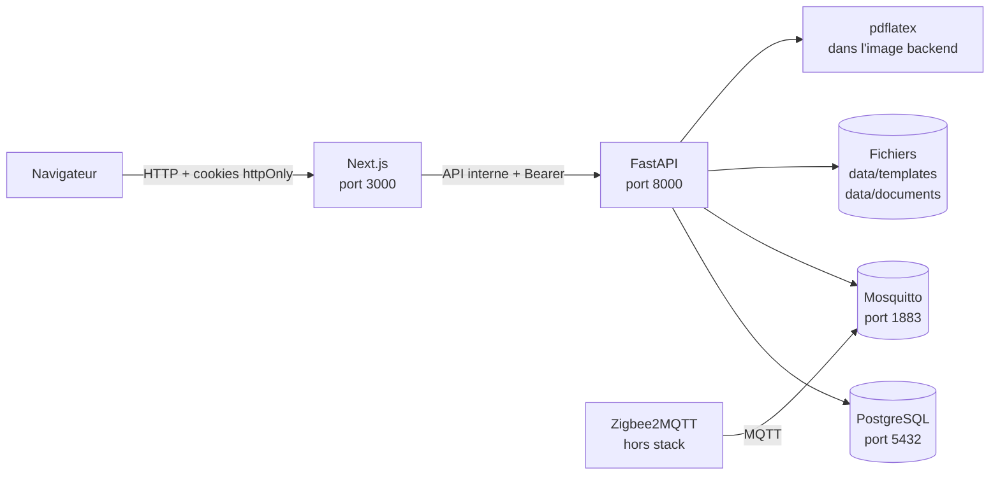

# Architecture

## Vue d'ensemble

haccpFlow est une application web monolithique déployée avec Docker Compose.
Elle est prévue pour être installée **une instance par client**, sur un serveur
ou en on-premise.

### Rôles des composants

| Composant | Rôle |
| --- | --- |
| `frontend` | Interface Next.js App Router, rendu serveur, formulaires, proxies de téléchargement. |
| `backend` | API FastAPI, règles métier, autorisations, accès PostgreSQL, rendu Jinja et compilation PDF. |
| `db` | PostgreSQL 16, source de vérité des données et des snapshots d'audit. |
| `mosquitto` | Broker MQTT authentifié. Le backend s'y connecte ; l'ingestion Zigbee viendra ensuite. |
| `Zigbee2MQTT` | Externe à la pile, installé près des capteurs, publie sous `MQTT_TOPIC_PREFIX`. |
| TeX Live | Installé dans l'image backend ; compile les modèles LaTeX avec `pdflatex`. |

## Flux principaux

### Authentification et session

1. Le navigateur soumet le formulaire de connexion au frontend.
2. Next.js appelle `POST /api/v1/auth/login` côté serveur.
3. Le backend vérifie le mot de passe Argon2id et renvoie un access token JWT et
   un refresh token opaque.
4. Next.js stocke les deux jetons dans des cookies `httpOnly`, `SameSite=Lax`
   (`Secure` si `SESSION_COOKIE_SECURE=true` ou `NODE_ENV=production`). Leurs
   durées de vie viennent de `expires_in` et `refresh_expires_in`.
5. Les appels suivants passent par `apiFetch`, qui ajoute le Bearer côté
   serveur. Le navigateur ne voit jamais les jetons.
6. Avant le rendu, `src/proxy.ts` vérifie l'expiration de l'access token et
   effectue le refresh si nécessaire. C'est le seul endroit qui peut toujours
   écrire les nouveaux cookies ; les composants serveur ne tentent plus de
   rotation.
7. Le backend accepte une réutilisation très courte du refresh token qui vient
   d'être tourné, pour absorber les requêtes concurrentes. Un rejeu après cette
   fenêtre révoque toute la famille de rotation, sans toucher aux autres
   connexions de l'utilisateur.

Voir [Frontend](./06-frontend.md) et [API](./04-api.md).

### Lecture et écriture des données

- Les pages Next.js sont des composants serveur : elles appellent l'API avec le
  cookie de session, jamais directement la base.
- Les mutations passent par des Server Actions ou des route handlers Next.js.
- Le backend applique systématiquement les règles de rôle (`require_role`) et
  l'isolation des données.

### Téléchargements et fichiers

Les exports CSV, les PDF générés, les sources LaTeX et les images passent par
des route handlers Next.js qui relaient le flux du backend. Le backend reste
responsable du contrôle d'accès et du `Content-Disposition`.

### Génération d'un document LaTeX

1. L'admin crée un modèle (source `.tex`) et ses variables.
2. L'opérateur ou l'admin saisit les variables locales dans l'interface.
3. Le backend résout les valeurs statiques et locales et rend le source avec
   Jinja en environnement sandboxé.
4. Les valeurs texte sont échappées pour LaTeX.
5. Les assets image du modèle sont copiés dans un répertoire temporaire.
6. `pdflatex` est exécuté deux fois, avec échappement shell désactivé, accès
   fichiers restreint, timeout et limite de sortie.
7. Le PDF est stocké sur disque et un snapshot des valeurs est enregistré en
   base dans `generated_documents`.

Détails : [Modèles LaTeX](./07-modeles-latex.md).

## Stockage

| Donnée | Emplacement |
| --- | --- |
| Base PostgreSQL | volume Docker `postgres_data` |
| Sources LaTeX | `backend/data/templates/<uuid>.tex` |
| Images de variables | `backend/data/templates/assets/<uuid>.jpg|png` |
| PDF générés | `backend/data/documents/<uuid>.pdf` |
| Données Mosquitto | volumes `mosquitto_data`, `mosquitto_log` |

Les répertoires `backend/data/` sont ignorés par Git et doivent être inclus
dans les sauvegardes.

## Principes transverses

- **UTC partout** : les dates et heures sont stockées en UTC ; le frontend
  formate en français.
- **RBAC backend** : l'interface masque les actions, mais ne décide jamais de
  l'autorisation.
- **Seuils configurables** : les seuils HACCP sont portés par les équipements,
  avec des valeurs par défaut issues de l'environnement.
- **Auditabilité** : les corrections de relevés, nettoyages, phases de
  pasteurisation et transports sont journalisées avec auteur et horodatage.
- **Suppression douce** : les référentiels (matériel, plans, lots, véhicules,
  transports, caisses) sont désactivés via `deleted_at`, pas supprimés
  physiquement.
- **Multi-tenant ready** : une instance par client aujourd'hui ; toute nouvelle
  requête devra pouvoir être filtrée par tenant sans changer les contrats.
- **Least privilege** : les secrets viennent de l'environnement, les ports
  PostgreSQL/MQTT sont limités à `127.0.0.1`, et les uploads sont validés.
