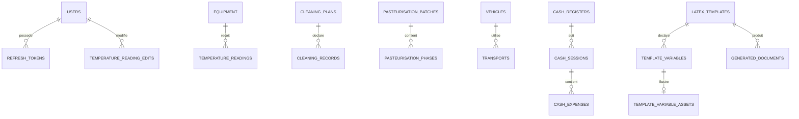

# Base de données

## Technologies

- PostgreSQL 16.
- SQLAlchemy 2 en mode asynchrone (`asyncpg`).
- Alembic pour les migrations.
- Modèles déclaratifs sous `backend/app/models/`.

## Conventions

- Clés primaires `UUID`.
- `created_at` et `updated_at` en `TIMESTAMPTZ`, maintenus par la base.
- Tous les horodatages sont en UTC.
- Suppression douce via `deleted_at` pour les référentiels et les lots.
- Les noms actifs sont souvent uniques sans tenir compte de la casse via un
  index partiel `lower(name) WHERE deleted_at IS NULL`.
- Les montants monétaires sont stockés en **centimes entiers**.
- Les seuils HACCP sont des colonnes `NUMERIC(5,2)` par matériel, jamais des
  constantes applicatives.
- Les corrections sont conservées dans des tables d'audit dédiées.

## Catalogue des tables

### Authentification

| Table | Rôle |
| --- | --- |
| `users` | Comptes, email unique, hash Argon2id, rôle `admin`/`operator`, actif, `auth_version`. |
| `refresh_tokens` | Refresh tokens hachés, expiration, révocation, chaîne de remplacement. |

### Chaîne du froid

| Table | Rôle |
| --- | --- |
| `equipment` | Matériel surveillé, type, seuils min/max, localisation, notes, `deleted_at`. |
| `temperature_readings` | Une ligne par matériel/date/créneau, valeur, conformité, source. |
| `temperature_reading_edits` | Audit des créations/corrections de relevés. |

### Nettoyage

| Table | Rôle |
| --- | --- |
| `cleaning_plans` | Plan PND, fréquence, produits, `deleted_at`. |
| `cleaning_records` | Déclarations de nettoyage, date, commentaire, `deleted_at`. |
| `cleaning_record_edits` | Audit des créations/corrections/suppressions. |

### Pasteurisation

| Table | Rôle |
| --- | --- |
| `pasteurisation_batches` | Lot : date, produit, numéro de lot, quantité, `deleted_at`. |
| `pasteurisation_phases` | Une ligne par phase et par lot (début, fin, température, observation). |
| `pasteurisation_phase_edits` | Audit des phases. |

### Transport

| Table | Rôle |
| --- | --- |
| `vehicles` | Véhicule : nom et/ou plaque, `deleted_at`. |
| `transports` | Déplacement : date, lieu, produit, lot, véhicule/libellé, checkpoints, `deleted_at`. |
| `transport_edits` | Audit des relevés et observations. |

### Caisses

| Table | Rôle |
| --- | --- |
| `cash_registers` | Caisse et son comptage courant par coupure, `deleted_at`. |
| `cash_sessions` | Suivi : comptage d'ouverture, comptage de clôture, auteurs, `closed_at`, `deleted_at`. |
| `cash_expenses` | Frais pro/perso : nom, quantité, prix unitaire en centimes, TVA. |

### Modèles et documents

| Table | Rôle |
| --- | --- |
| `latex_templates` | Métadonnées du modèle : nom, nom normalisé unique, fichier source UUID, taille, SHA-256, auteur. |
| `template_variables` | Variables du modèle : nom Jinja, libellé, nature, type, valeur/défaut. |
| `template_variable_assets` | Image unique d'une variable `image` (JPEG/PNG). |
| `generated_documents` | PDF généré : modèle, auteur, snapshot JSONB des valeurs, fichier, taille, SHA-256. |

## Relations principales



## Audit

Les tables `*_edits` conservent au minimum :

- l'identifiant de l'entité ;
- l'action (`created`, `updated`, `deleted`) ;
- les anciennes et nouvelles valeurs des champs modifiés ;
- l'auteur (`changed_by`) ;
- l'horodatage (`changed_at`).

Les snapshots de génération de PDF sont dans
`generated_documents.values` (JSONB) : ils conservent les valeurs statiques,
locales, les lignes produits et le nom d'image utilisés.

## Migrations Alembic

Les révisions vivent dans `backend/alembic/versions/` :

| Révision | Objet |
| --- | --- |
| `0001_initial` | Utilisateurs, refresh tokens. |
| `0002_equipment` | Matériel. |
| `0003_temperature_readings` | Relevés et audit. |
| `0004_cleaning_plans` | Plans, déclarations, audit. |
| `0005_pasteurisation` | Lots, phases, audit. |
| `0006_vehicles_transports` | Véhicules, transports, audit. |
| `0007_cash_registers` | Caisses. |
| `0008_cash_sessions` | Suivis et frais. |
| `0009_latex_templates` | Modèles LaTeX. |
| `0010_template_variables` | Variables et documents générés. |
| `0011_product_rows_variable` | Type `products`. |
| `0012_template_image_variables` | Type `image` et assets. |
| `0013_refresh_token_family` | Famille de rotation des refresh tokens. |
| `0014_user_auth_version` | Version d'authentification des comptes. |

`users.auth_version` est incrémenté lors d'un changement de rôle, d'une
désactivation ou d'une réinitialisation de mot de passe. Les access tokens
portent cette version dans le claim JWT `ver` ; un token qui ne correspond plus
à la version du compte est rejeté.

### Ajouter une migration

1. Modifier les modèles sous `backend/app/models/`.
2. Créer une révision :
   ```sh
   cd backend
   uv run alembic revision -m "description"
   ```
3. Renseigner `down_revision` et les opérations `upgrade`/`downgrade`.
4. Mettre à jour [05-base-de-donnees.md](./05-base-de-donnees.md).
5. Lancer la suite d'intégration : les migrations sont appliquées sur une base
   jetable.
6. Redémarrer le backend pour appliquer `alembic upgrade head`.

## Multi-tenant

Le schéma actuel n'a pas de colonne `tenant_id` : le cloisonnement repose sur
une instance par client. Toute évolution doit rester compatible avec l'ajout
d'un tenant :

- ne jamais coder d'identifiant de tenant en dur ;
- prévoir le filtrage par tenant dans les requêtes de service ;
- appliquer le contrôle côté backend, jamais seulement dans l'interface ;
- documenter les index et contraintes qui deviendront `(tenant_id, ...)`.

## Sauvegarde

La base et les fichiers doivent être sauvegardés ensemble pour rester cohérents :

- volume PostgreSQL `postgres_data` ;
- `backend/data/templates/` ;
- `backend/data/documents/`.

Procédure : [Exploitation](./08-exploitation.md).
