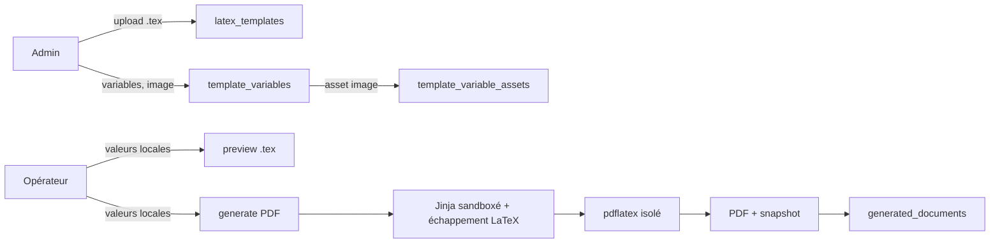

# Modèles LaTeX et génération PDF

## Vue d'ensemble

Le sous-système permet à un administrateur d'importer un modèle `.tex`, de
configurer des variables, puis à un opérateur de générer un PDF avec les valeurs
du moment. Chaque génération est conservée dans l'historique avec un snapshot
des valeurs utilisées.



## Modèle source

- Format : `.tex`, texte UTF-8, 256 Kio par défaut
  (`TEMPLATE_MAX_UPLOAD_BYTES`).
- Validation de la syntaxe Jinja à l'import.
- Stockage disque : `backend/data/templates/<uuid>.tex`.
- Métadonnées en base : nom, nom normalisé unique, fichier d'origine, taille,
  SHA-256, auteur, dates.

### Opérations

| Opération | Route | Accès |
| --- | --- | --- |
| Lister | `GET /api/v1/templates` | admin, opérateur |
| Importer | `POST /api/v1/templates` (multipart) | admin |
| Remplacer le source | `PUT /api/v1/templates/{id}` (multipart) | admin |
| Renommer | `PATCH /api/v1/templates/{id}` (`{"name": "..."}`) | admin |
| Télécharger le source | `GET /api/v1/templates/{id}/download` | admin |

Il n'existe pas encore de suppression ni de versionnement : pour changer le
source, on le remplace ; pour revenir à une version antérieure, il faut
conserver une copie.

Le nom est unique sans tenir compte de la casse. Le renommage ne touche ni au
source, ni aux variables, ni aux documents déjà générés.

## Variables

Une variable appartient à un modèle et possède :

- un identifiant Jinja (`name`) unique par modèle ;
- un libellé et une description pour l'interface ;
- une nature `static` ou `local` ;
- un type de valeur.

### Natures

| Nature | Comportement |
| --- | --- |
| `static` | Valeur fixée par l'admin, jamais demandée à la génération. |
| `local` | Valeur fournie à la génération, avec valeur par défaut facultative. |

Une variable locale sans défaut est obligatoire. Une variable locale avec
défaut est facultative : si la valeur n'est pas fournie, le défaut s'applique.

### Types

| Type | Valeur | Usage |
| --- | --- | --- |
| `text` | Chaîne | Noms, adresses, mentions. |
| `number` | Décimal | Quantités, prix. |
| `date` | ISO `YYYY-MM-DD` | Dates. |
| `products` | Liste de lignes | Tableau dynamique de produits. |
| `image` | Asset JPEG/PNG | Image statique (logo). |

### Lignes produits

Forme d'une ligne :

```json
{ "designation": "BOCAL - CORAILLES", "pots": 10, "prix": "3.95" }
```

Règles :

- 0 à 100 lignes ;
- désignation obligatoire, 200 caractères max ;
- pots entiers positifs ;
- prix décimal positif, normalisé avec un point ;
- le montant de ligne et les totaux sont calculés dans le template.

### Images

- Type `image` réservé aux variables `static`.
- JPEG ou PNG, 5 Mio max (`TEMPLATE_IMAGE_MAX_BYTES`).
- Signature binaire vérifiée, pas seulement l'extension.
- Une image par variable, stockée sous
  `backend/data/templates/assets/<uuid>.<jpg|png>`.
- Routes :
  - `PUT .../variables/{id}/image` (upload/remplacement) ;
  - `GET .../variables/{id}/image` (aperçu, admin) ;
  - `DELETE .../variables/{id}/image`.

### API des variables

| Méthode | Route | Accès |
| --- | --- | --- |
| `GET` | `/templates/{id}/variables` | admin, opérateur |
| `POST` | `/templates/{id}/variables` | admin |
| `PUT` | `/templates/{id}/variables/{variable_id}` | admin |
| `DELETE` | `/templates/{id}/variables/{variable_id}` | admin |

La lecture renvoie aussi `used_in_template`, calculé en parsant le source.
Supprimer une variable utilisée est autorisé mais cassera les générations
suivantes ; l'interface avertit.

## Jinja dans les templates

### Délimiteurs

Les délimiteurs par défaut de Jinja entrent en conflit avec LaTeX (`{%` dans
les définitions de macros, `{{` dans les groupes). haccpFlow utilise donc :

| Élément | Syntaxe |
| --- | --- |
| Variable | `<< nom >>` |
| Bloc | `<% if ... %> ... <% endif %>` |
| Commentaire | `<# ... #>` |

Les `{`, `{{` et `{%` de LaTeX restent littéraux.

### Sécurité et échappement

- `SandboxedEnvironment` + `StrictUndefined`.
- Aucun global personnalisé.
- Les valeurs texte sont échappées automatiquement pour LaTeX :
  `\ & % $ # _ { } ~ ^`.
- `|safe` permet à un admin d'insérer volontairement du LaTeX brut.
- Les erreurs d'attribut interdites et les variables manquantes produisent une
  erreur de rendu explicite.

### Filtres disponibles

Tous les filtres Jinja standards, plus :

| Filtre | Exemple | Résultat |
| --- | --- | --- |
| `euro` | `<< 1234.5|euro >>` | `€1 234,50` |

### Exemple

```latex
\newcommand{\clientNom}{<< client_nom >>}
\newcommand{\totalPots}{<< total_pots >>}

<% for ligne in lignes_produits %>
  \ligneBL{<< ligne.designation >>}
    {<< ligne.pots >>}
    {<< ligne.prix|euro >>}
    {<< (ligne.pots * ligne.prix)|euro >>}
<% endfor %>
```

## Aperçu et génération

### Aperçu

`POST /api/v1/templates/{id}/preview` (admin) avec :

```json
{
  "values": {
    "client_nom": "Biocoop",
    "lignes_produits": [
      { "designation": "Bocal A", "pots": 10, "prix": "3.95" }
    ]
  }
}
```

Réponse : le source `.tex` rendu, en `text/plain`, sans compilation ni
stockage. Les images sont résolues mais pas copiées.

### Génération

`POST /api/v1/templates/{id}/generate` (admin ou opérateur) avec le même
payload. Le backend :

1. résout les variables statiques et locales ;
2. valide les types et la présence des valeurs ;
3. rend le source avec Jinja ;
4. collecte et copie les images dans un répertoire temporaire ;
5. compile deux fois avec `pdflatex` ;
6. stocke le PDF sous `backend/data/documents/<uuid>.pdf` ;
7. enregistre `generated_documents` avec le snapshot des valeurs.

Erreurs principales :

| Code | Sens |
| --- | --- |
| `template_values_missing` | variables locales obligatoires absentes |
| `template_values_unknown` | clé fournie sans variable correspondante |
| `template_values_static` | tentative de fournir une variable statique |
| `template_value_invalid` | type/valeur invalide |
| `template_render_failed` | erreur Jinja, sandbox ou variable manquante |
| `template_image_missing` | variable image sans asset |
| `template_compilation_failed` | `pdflatex` en erreur (log dans `context.log`) |
| `template_compilation_timeout` | délai dépassé |

## Compilation PDF

- `pdflatex` est installé dans l'image backend (TeX Live minimal :
  latex-base, latex-recommended, fonts-recommended, lang-french).
- Compilation dans un répertoire temporaire isolé.
- Deux passes pour les références.
- `-no-shell-escape`.
- `openin_any=p` et `openout_any=p`.
- `TEXMFVAR`, `HOME`, `TMPDIR` pointent vers le répertoire temporaire.
- Timeout par passe (`TEMPLATE_PDF_TIMEOUT_SECONDS`, 30 s par défaut).
- Taille de sortie limitée (`TEMPLATE_PDF_MAX_OUTPUT_BYTES`, 20 Mio).
- Limite de processus simultanés (`TEMPLATE_PDF_CONCURRENCY`, 2).
- Nettoyage systématique du répertoire temporaire.
- Les assets image sont copiés avant compilation.

Ce n'est pas un bac à sable système complet : les modèles sont écrits par des
admins de confiance, mais l'exécution shell et les accès fichiers sont
restreints.

## Historique des documents

- `GET /api/v1/documents` et `GET /api/v1/documents/{id}/download`.
- Accessible à tous les utilisateurs connectés.
- Chaque document contient : modèle, auteur, fichier, taille, SHA-256, valeurs
  résolues, date.
- Les valeurs image sont stockées sous forme `{filename, sha256}`.
- Les lignes produits restent une liste JSON dans le snapshot.
- L'export CSV `documents` expose ces informations et une colonne par variable.

## Modèle de bon de livraison fourni

Le dossier local `templates/delivery-note/` contient le modèle La LEGU et son
logo. Le seed [`scenario/seed_delivery_note.py`](../scenario/seed_delivery_note.py)
est idempotent :

1. il crée ou remplace le modèle `bon-de-livraison` ;
2. il crée/met à jour 22 variables ;
3. il téléverse `logo-la-legu.jpg` sur la variable `logo`.

Variables principales :

| Type | Variables |
| --- | --- |
| Statiques texte | `vendeur_nom`, `vendeur_adresse_1`, `vendeur_adresse_2`, `vendeur_pays`, `vendeur_email`, `vendeur_siret`, `vendeur_ville`, `vendeur_tva`, `vendeur_telephone`, `entete_quantite`, `mention_tva`, `mention_bio` |
| Statique image | `logo` |
| Locales texte | `bl_numero`, `bl_reference`, `client_nom`, `client_adresse_1`, `client_adresse_2`, `client_ape`, `client_siret`, `unite_quantite` |
| Locale tableau | `lignes_produits` |

Le template calcule `totalPots` et `totalMontant` à partir des lignes.

## Limites actuelles

- Pas de suppression de modèle ni de versionnement.
- Une seule image par variable, uniquement statique.
- Pas d'upload d'image locale à chaque génération (prévu).
- Pas de gestion d'assets autres que les images de variables.
- Le logo n'est pas inclus dans le `.tex` : il doit être uploadé comme asset.
- La compilation dépend de TeX Live ; un rebuild de l'image est nécessaire
  après changement des paquets.
